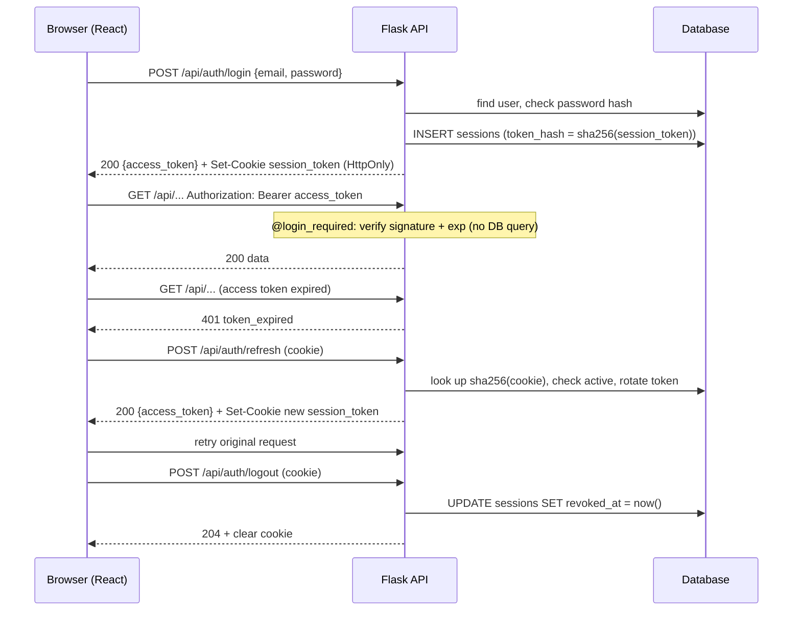

# Architecture

Future Code is a cloud-native full-stack web application that helps
software engineering candidates prepare for technical interviews using
AI-powered tools such as resume analysis, mock interviews, coding
challenges, and personalized feedback.

The application follows a client-server architecture where the React
frontend communicates with a Flask REST API backend. The backend manages
authentication, business logic, database operations, AI integrations, and
file storage through PostgreSQL, AWS services, and the OpenAI API.

## Table of Contents

- High-Level Architecture
- Backend Structure
- Authentication Flow
- Resume Upload Flow
- AI Processing
- Database Architecture
- Deployment Architecture

---

## High-Level Architecture


> Editable source: [architecture.drawio](../design/Architecture/Overview.drawio)

---

## Backend Structure

The Flask app is built by an application factory, `create_app()` in `backend/app.py`:

1. Load `Config` from environment variables (`backend/config.py` + `.env`).
2. Initialize the shared extensions from `backend/extensions.py`: `cors`, `db` (SQLAlchemy) and `migrate` (Flask-Migrate).
3. Register one Blueprint per resource through `routes.register_routes(app)`.

Requests go through three layers:

```
routes/ (Blueprints, HTTP only) → services/ (business logic) → models/ (SQLAlchemy)
        ↑
  utils/auth.py decorators (@login_required, @role_required) run before the view
```

See [FILE_STRUCTURE.MD](./FILE_STRUCTURE.MD) for where each piece lives.

---

## Authentication Flow

The client authenticates with a short-lived **JWT access token** (15 min, sent as a Bearer header) and a long-lived, revocable **session token** (an `HttpOnly` cookie backed by the `sessions` table). See [SECURITY.MD](./SECURITY.MD) for the full design.


